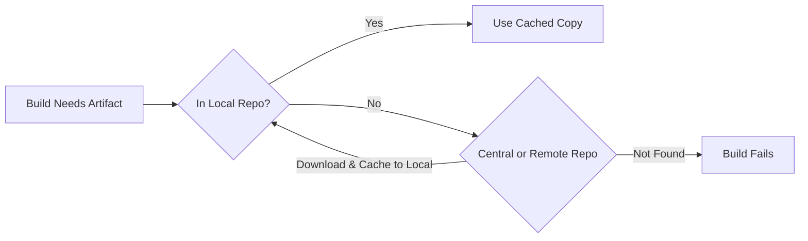

# Maven: Build Automation for Java

## Table of Contents

* [1. Introduction to Maven](#1-introduction-to-maven)
* [2. Project Coordinates](#2-project-coordinates)
    * [2.1 The Anatomy of Coordinates](#21-the-anatomy-of-coordinates)
    * [2.2 SNAPSHOT vs. Release Versions](#22-snapshot-vs-release-versions)
    * [2.3 Standard Project Layout](#23-standard-project-layout)
* [3. Project Object Model (POM)](#3-project-object-model-pom)
    * [3.1 The Structure of `pom.xml`](#31-the-structure-of-pomxml)
    * [3.2 POM Inheritance](#32-pom-inheritance)
* [4. Maven Repositories](#4-maven-repositories)
    * [4.1 The Three Repository Types](#41-the-three-repository-types)
    * [4.2 How Dependency Resolution Works](#42-how-dependency-resolution-works)
* [5. Maven Lifecycles](#5-maven-lifecycles)
    * [5.1 Phases vs. Goals](#51-phases-vs-goals)
    * [5.2 The Default Lifecycle](#52-the-default-lifecycle)
    * [5.3 The Clean and Site Lifecycles](#53-the-clean-and-site-lifecycles)

***

## 1. Introduction to Maven

**Maven** is a build automation and project management tool for Java (and other JVM languages), created by the Apache Software Foundation. It replaces the ad-hoc, script-by-script approach to building software with a single, standardized command that can compile, test, package, and deploy a project automatically.

Before Maven, teams relied on custom shell scripts (or Ant) that scattered build logic across every developer's machine. Maven centralizes that logic behind a declarative configuration file, so the answer to "how do I build this project?" is always the same: run `mvn`.

| Feature | What it Solves |
| :--- | :--- |
| **Convention over configuration** | Provides a standard project layout, so any developer recognizes the structure of any Maven project. |
| **Dependency management** | Automatically downloads libraries your code needs, including their transitive dependencies. |
| **Standardized lifecycle** | Every project follows the same ordered build phases, replacing bespoke scripts. |
| **Reproducible builds** | The same POM and version produce the same result on any machine, every time. |
| **Plugin ecosystem** | Compilers, test runners, and packagers are just plugins that bind to lifecycle phases. |

>[!NOTE]
> The core principle is **Convention over Configuration**: Maven provides sensible defaults so you only configure what is genuinely different about your project.

[↑ Back to Table of Contents](#table-of-contents)
***

*Now that we understand what Maven does, the next question is how Maven identifies a project. Every build and dependency in Maven is tracked by a unique set of labels called coordinates.*

## 2. Project Coordinates

In the same way that a mailing address identifies one building, **project coordinates** uniquely identify one artifact (a project, a library, or any packaged unit of code) inside the Maven universe. Every artifact Maven can build or download is addressable by this identity.

### 2.1 The Anatomy of Coordinates

A full set of coordinates is a combination of four elements. Three are required, and the fourth has a default value.

| Element | Example | Purpose |
| :--- | :--- | :--- |
| **`groupId`** | `com.revature` | The reverse-domain namespace that groups related projects (usually your company or organization's domain). |
| **`artifactId`** | `espresso-app` | The name of this specific artifact within the group. |
| **`version`** | `1.0.0` | The release iteration of the artifact. Versionless artifacts are not allowed. |
| **`packaging`** | `jar` | How the artifact is packaged (`jar`, `war`, `pom`, `maven-plugin`). Defaults to `jar`. |

Together these form the artifact's coordinates, conventionally written as a three-part string with colons:

```
com.revature:espresso-app:1.0.0
```

> [!IMPORTANT]
> The `groupId` + `artifactId` + `version` combination must be **globally unique**. Two different artifacts cannot share the same full coordinate, since that is the exact key Maven uses to find and cache them.

### 2.2 SNAPSHOT vs. Release Versions

A version tells Maven not just *which* artifact, but *how final* it is.

* **Release version** (`1.0.0`): a stable, published version. Once released, it is normally **immutable** — a given coordinate always returns the same content.
* **SNAPSHOT version** (`1.0.0-SNAPSHOT`): a development build. The `-SNAPSHOT` suffix tells Maven this artifact is still changing, so it will **re-download** it from the repository on each build rather than trusting a cached copy.

| Property | Release | SNAPSHOT |
| :--- | :--- | :--- |
| **Stability** | Frozen, published | Still under development |
| **Caching** | Fetched once, cached | Re-fetched on each build |
| **Use case** | Releases to consumers | Team-internal development |
| **Example** | `1.0.0` | `1.0.0-SNAPSHOT` |

### 2.3 Standard Project Layout

Part of Maven's convention over configuration is a fixed directory structure that Maven assumes unless told otherwise. Two directories matter most:

* `src/main/java` — production source code.
* `src/test/java` — test source code.

Output from the build is written to a `target/` directory, which holds compiled classes, test reports, and the final packaged artifact. Because the layout is assumed, a Maven project requires far less configuration than a comparable custom-script project.

[↑ Back to Table of Contents](#table-of-contents)
***

*Coordinates tell Maven *what* the project is. The file that records those coordinates, and every other build setting, is the POM.*

## 3. Project Object Model (POM)

The **Project Object Model (POM)** is the fundamental unit of work in Maven. It is an XML file named `pom.xml`, located at the root of every project, that describes everything Maven needs to know about that project: its coordinates, its dependencies, its build configuration, and its relationship to parent projects.

### 3.1 The Structure of `pom.xml`

A minimal POM needs only the coordinates from Section 2, wrapped in the Maven project namespace:

```xml
<project xmlns="http://maven.apache.org/POM/4.0.0">
    <modelVersion>4.0.0</modelVersion>

    <groupId>com.revature</groupId>
    <artifactId>espresso-app</artifactId>
    <version>1.0.0</version>
    <packaging>jar</packaging>
</project>
```

The full POM adds a range of configuration blocks, the most common of which are:

| Element | Purpose |
| :--- | :--- |
| **`modelVersion`** | The POM version Maven parses (`4.0.0`). Always present. |
| **Coordinates** | `groupId`, `artifactId`, `version`, `packaging` from Section 2. |
| **`properties`** | Reusable key-value settings (e.g. a shared language-version flag). |
| **`dependencies`** | The external libraries the project needs, listed by their coordinates + scope. |
| **`build`** | Plugins, their configurations, and output settings. |
| **`parent`** | The coordinates of a parent POM this one inherits from. |
| **`dependencyManagement`** | Central place to pin versions so child projects don't repeat them. |

Dependencies are declared by pointing at the dependency's own coordinates and scope (e.g. `compile` or `test`):

```xml
<dependencies>
    <dependency>
        <groupId>org.junit.jupiter</groupId>
        <artifactId>junit-jupiter</artifactId>
        <version>5.10.0</version>
        <scope>test</scope>
    </dependency>
</dependencies>
```

The `<scope>test</scope>` indicates this dependency is available during testing only and is not packaged into the final artifact.

> [!TIP]
> When an element declares anything (a plugin version, a dependency version), the element is only considered `pom`-typed when `<packaging>pom</packaging>` is set — that pairing marks the file as a *parent/aggregator* POM rather than a buildable project.

### 3.2 POM Inheritance

POM configuration is **inheritable**. A child project can declare a `parent` and automatically receive that parent's dependencies, properties, and build settings, only overriding what differs:

* The **Super POM** is Maven's built-in default POM. Every Maven project inherits from it implicitly, which is why a minimal POM can be so short — the defaults already live in the Super POM.
* A **custom parent POM** (with `<packaging>pom</packaging>`) centralizes shared configuration across a group of modules, so child projects stay small and consistent.

[↑ Back to Table of Contents](#table-of-contents)
***

*With coordinates and the POM in place, Maven can locate and download whatever the project needs. Those downloads come from repositories.*

## 4. Maven Repositories

A **repository** is a storage location for Maven artifacts (JARs, POMs, plugins). When your POM declares a dependency, Maven must go find that artifact somewhere — repositories are the "somewhere."

### 4.1 The Three Repository Types

Maven draws from up to three repositories, each with a distinct role.

| Repository | Location | Role |
| :--- | :--- | :--- |
| **Local repository** | On your machine (`~/.m2/repository`) | The cache of everything Maven has already downloaded or installed. Always checked first. |
| **Central repository** | `repo.maven.apache.org` | Maven's default public repository, hosting most open-source libraries. Checked when the local cache misses. |
| **Remote repository** | Any custom URL (e.g. a corporate Nexus/Artifactory server) | A private repository for internal or custom artifacts. Checked when the artifact is not in central. |

The local repository is the reason a project builds offline after its first successful build — Maven caches every artifact it has fetched, so subsequent builds never leave the machine.

### 4.2 How Dependency Resolution Works

When a build references a dependency, Maven resolves it through a fixed lookup order.



1. Maven checks the **local repository** for the artifact's exact coordinates.
2. If absent, it queries the configured **central/remote** repositories.
3. The downloaded artifact is **cached to the local repository** for future builds.
4. If no repository has it, the build **fails** with a dependency-not-found error.

> [!WARNING]
> A SNAPSHOT dependency is intentionally *not* trusted from the local cache — Maven re-checks the remote repository on each build so you always get the latest development copy. This is what makes SNAPSHOTs useful, and also why they slow builds down.

> [!NOTE]
> Repositories are not the same as build output. The local `~/.m2/repository` cache and the per-project `target/` directory store entirely different things: the former holds downloaded libraries, the latter holds the current project's compiled results.

[↑ Back to Table of Contents](#table-of-contents)
***

*Repositories tell Maven where artifacts come from. The lifecycle tells Maven what to do with them, and in what order.*

## 5. Maven Lifecycles

A **lifecycle** is the ordered sequence of build stages (phases) that Maven runs through to build and deploy a project. You never tell Maven *how* to compile or package; you name a point in the lifecycle and Maven runs every phase up to and including it.

### 5.1 Phases vs. Goals

The distinction between phases and goals is central to how Maven works.

* **Phase** — a stage in the lifecycle (e.g. `compile`, `test`). Phases are just markers in a sequence.
* **Goal** — a specific task that actually does work, supplied by a plugin and *bound* to a phase.

A phase with no bound goals does nothing on its own; the plugin's goals attached to that phase are what produce the compiled classes or the packaged JAR.

> [!IMPORTANT]
> This is the most common conflation: a phase is *when* something happens in the build sequence, while a goal is *what* happens. Running `mvn package` triggers the `package` phase plus every phase before it, but the real work is done by the goals bound to those phases.

### 5.2 The Default Lifecycle

The **default lifecycle** is the main build sequence and by far the most important. Its key phases, in order:

| Phase | What happens |
| :--- | :--- |
| **`validate`** | Checks the project is correct and all needed info is available. |
| **`compile`** | Compiles the source code in `src/main/java`. |
| **`test`** | Runs tests against the compiled source using a test framework. |
| **`package`** | Packages the compiled code into its distributable form (a JAR/WAR). |
| **`verify`** | Runs any extra checks on the package (e.g. integration tests). |
| **`install`** | Copies the package into the local repository for use by other projects. |
| **`deploy`** | Copies the package to a remote repository for external use. |

Because phases are cumulative, a single command executes a whole chain:

* `mvn compile` → validate + compile
* `mvn test` → validate + compile + test
* `mvn package` → validate + compile + test + package

> [!TIP]
> This cumulative behavior is a huge time-saver: `mvn package` automatically runs `validate`, `compile`, and `test` first, so you never have to chain commands yourself.

### 5.3 The Clean and Site Lifecycles

Two shorter built-in lifecycles complement the default one.

| Lifecycle | Purpose |
| :--- | :--- |
| **`clean`** | Removes the `target/` directory and any prior build output. |
| **`site`** | Generates project documentation for a website report. |

`clean` is frequently combined with the default lifecycle in a single invocation: `mvn clean install` first wipes the previous output, then runs the default lifecycle all the way through `install`. This is a common idiom for guaranteeing a build starts from a truly clean state.

[↑ Back to Table of Contents](#table-of-contents)
