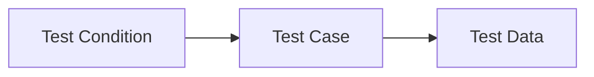
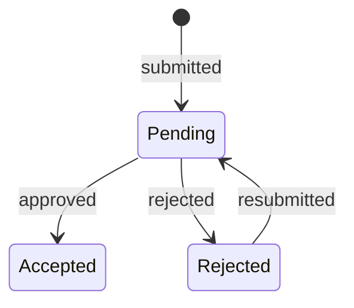
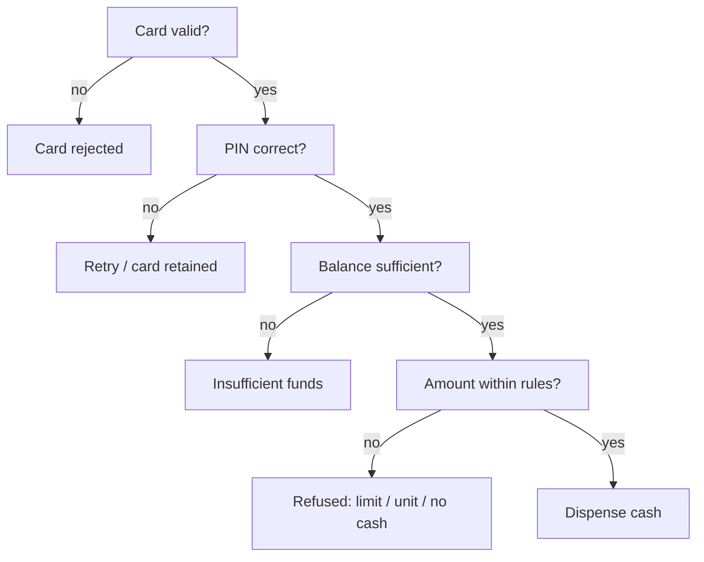

# Test Case Design

## Table of Contents

* [1. High-Level Overview](#1-high-level-overview)
* [2. The Anatomy of a Test Case](#2-the-anatomy-of-a-test-case)
* [3. Testing Principles](#3-testing-principles)
* [4. Test Design Techniques](#4-test-design-techniques)
    * [4.1 Black Box (Specification-Based)](#41-black-box-specification-based)
        * [4.1.1 Equivalence Partitioning](#411-equivalence-partitioning)
        * [4.1.2 Boundary Value Analysis](#412-boundary-value-analysis)
        * [4.1.3 Decision Table Testing](#413-decision-table-testing)
        * [4.1.4 State Transition Testing](#414-state-transition-testing)
        * [4.1.5 Use Case Testing](#415-use-case-testing)
    * [4.2 White Box (Structure-Based)](#42-white-box-structure-based)
        * [4.2.1 Statement / Line Coverage](#421-statement--line-coverage)
        * [4.2.2 Decision & Condition Testing](#422-decision--condition-testing)
    * [4.3 Experience-Based](#43-experience-based)
        * [4.3.1 Error Guessing](#431-error-guessing)
        * [4.3.2 Exploratory Testing](#432-exploratory-testing)
        * [4.3.3 Checklist Testing](#433-checklist-testing)
* [5. Executing Software-Driven Tests](#5-executing-software-driven-tests)
    * [5.1 Data-Driven Testing](#51-data-driven-testing)

***

## 1. High-Level Overview

**Test case design** is the craft of turning what needs to be verified into concrete, runnable tests. It sits between deciding *what* to test and *actually* executing those tests — and the quality of that design largely determines how effectively defects are found.

| Test Design Technique | Perspective | Input Used | Example Techniques |
| :--- | :--- | :--- | :--- |
| **Black Box (Specification-Based)** | Tests designed from *requirements and behavior*, ignoring internal implementation. | Requirements, user stories, specifications. | Equivalence Partitioning, Boundary Value Analysis, Decision Table, State Transition, Use Case Testing. |
| **White Box (Structure-Based)** | Tests designed from the *internal structure* of the code. | Source code, architecture, branches. | Statement Coverage, Decision & Condition Testing. |
| **Experience-Based** | Tests designed from *tester knowledge and judgment*. | Prior experience, intuition, exploratory insight. | Error Guessing, Exploratory Testing, Checklist Testing. |

> [!NOTE]
> These families are not mutually exclusive. A real test effort typically mixes them — you use black-box techniques to design against the requirements, white-box coverage to prove the code is exercised, and experience-based methods to test the places that fool the other two. The right blend depends on your test object and objectives (see Testing Principles, Section 3).

[↑ Back to Table of Contents](#table-of-contents)

***

*Every technique below produces test cases, so let's first be precise about what a test case actually is and where it comes from.*

## 2. The Anatomy of a Test Case

A **test case** is a formal, detailed set of **preconditions**, **inputs**, **actions**, and **expected results** — the resources and steps needed to perform a specific piece of testing. On execution, the actual outcome is compared to the expected: a match means the test **passes**; a deviation reveals a **defect**.

Test cases don't appear from nowhere — they are derived from a chain:



| Component | Description |
| :--- | :--- |
| **Test Condition** | The specific aspect of the software to be checked. |
| **Test Case** | The concrete steps, inputs, and expected result that validate the condition. |
| **Test Data** | The values used as input to the test case. |

Where do the conditions come from? From the **test basis** (requirements, design docs, risk analysis) via **test analysis**. Defining the condition clearly ("verify login rejects a 51-character password") is what makes the resulting test case unambiguous.

> [!TIP]
> When designing a test case, ask: *What is the condition I'm validating? What input exercises it? What outcome proves success?* If you can't answer all three, the test case isn't ready. Clear conditions make it possible to design cases that aren't redundant — which is exactly what the techniques in Section 4 help you do.

[↑ Back to Table of Contents](#table-of-contents)

***

*Before diving into techniques, it's worth agreeing on the principles that guide all test design — they explain *why* we don't just write "all the tests."*

## 3. Testing Principles

A set of **testing principles** underlies every good test design effort. They are the strategic assumptions that justify *how* and *how much* you test:

| Principle | What It Means | Practical Consequence |
| :--- | :--- | :--- |
| **Testing reveals defects, not their absence** | Finding zero defects does not prove there are none — it only means the tests run found nothing. | Design tests to *find* problems, not to confirm everything works. |
| **Exhaustive testing is impossible** | It's impractical to test every input/scenario combination. | Prioritize critical features and highest-risk requirements first. |
| **Test early** | The sooner testing starts, the earlier defects are caught. | Begin static testing as early as possible; run dynamic testing as soon as code is runnable. |
| **Defects cluster** | A small number of modules usually holds most of the defects. | Concentrate extra testing where defects already appear — and just downstream of them. |
| **Tests wear out (the "pesticide paradox")** | Repeatedly running the same tests eventually exhausts the defects they can find. | Add new tests for new features and edge cases — but keep old ones for regression safety. |
| **Testing is contextual** | There's no universal testing recipe. | Tailor approach and depth to the specific system, requirements, and risks. |
| **Absence-of-error fallacy** | Zero defects ≠ correct product. | Validate against requirements and user needs, not just defect count. |

> [!IMPORTANT]
> **"Tests wear out" is not a reason to delete old tests.** When a test stops *discovering new* defects, that's fine — keep it as a regression check. Removing it means previously fixed defects can silently return. The pesticide paradox is about adding *new* tests alongside the old, not replacing them.

[↑ Back to Table of Contents](#table-of-contents)

***

*With principles in hand, we can organize the techniques. The cleanest split is by what the test is designed from: the specification (black box), the code (white box), or the tester's judgment (experience).*

## 4. Test Design Techniques

### 4.1 Black Box (Specification-Based)

**Black box testing** designs tests from the system's **specifications, design documentation, and expected behavior** — with the internal implementation deliberately unavailable and uninfluencing. Because the tester works from the outside in, black-box techniques are the natural fit for **system** and **acceptance** level testing, but they apply broadly.

#### 4.1.1 Equivalence Partitioning

**Equivalence partitioning (EP)** divides test data into **classes** of input that the software is expected to handle the same way, then uses **a single representative value** from each class to test it. This collapses "test every possible input" down to "test each distinct behavior once."

- **Why use it:** when the potential input space is overwhelmingly large, or requirements don't define crisp boundaries.
- **Example:** a profile-picture upload. Don't try uploading every kind of non-image file — there are too many. Pick one invalid file type to represent the whole class of "invalid inputs," and one valid image to represent "valid inputs."

> [!WARNING]
> **A valid partition is more than "some grouping."** Partitions must be classes that the software truly treats *equivalently* — that's the whole basis of the technique. Zeroing in on the boundaries of those partitions is where **Boundary Value Analysis** (next) refines EP.

#### 4.1.2 Boundary Value Analysis

**Boundary value analysis (BVA)** targets the **edges of the valid/invalid ranges** defined by requirements, because defects cluster at boundaries. When business rules set limits (e.g., a username length), those limits create natural boundaries, and you select test data *just inside* and *just outside* each one.

- **Typical usage:** determine the boundaries, then for each fetch values just within and just outside the boundary so each value represents its region of data — lower out-of-bounds, lower inner bound, upper inner bound, upper out-of-bounds.

> [!IMPORTANT]
> **BVA is not a replacement for EP — it's a refinement.** Equivalence partitioning gives you the *classes*; boundary value analysis zooms in on the *edges* of those classes, because that's where most boundary-related defects actually live. Professional test design uses them together.

#### 4.1.3 Decision Table Testing

A **decision table** organizes combinations of conditions and the expected outcome for each combination. It's the right technique when a feature depends on several inputs acting together, like a form with multiple fields.

| Condition | Combination 1 | Combination 2 | Combination 3 | Combination 4 |
| :--- | :---: | :---: | :---: | :---: |
| Username is valid | ✓ | ✓ | ✗ | ✗ |
| Password is valid | ✓ | ✗ | ✓ | ✗ |
| **Expected outcome** | Logged in | Rejected | Rejected | Rejected |

- **Why it matters:** it guarantees complete coverage of all input combinations and highlights *redundant* combinations (here, combinations 2 and 3 yield the same result but from different causes, so both are worth testing).

> [!TIP]
> The login example above shows the real power of a decision table: it forces you to think through *every* combination of conditions explicitly, rather than only the happy path plus one failure case. Missed combinations are usually missed test cases.

#### 4.1.4 State Transition Testing

**State transition testing** applies whenever a system has several **states** that change in response to actions. A **state transition diagram** maps the states and the transitions between them, including a starting state and one or more ending states.

- **Example:** a reimbursement request can be `pending`, `accepted`, or `rejected`, where `pending` is the start state and `accepted` is the end state. Actions move the request between states; each transition has a permitted action.



| State | Allowed Outgoing Actions (Positive Tests) |
| :--- | :--- |
| **Pending** (start) | submit → stays `pending` · approve → **`accepted`** · reject → **`rejected`** |
| **Rejected** | resubmit → **`pending`** |
| **Accepted** (end) | *(terminal — no legal outgoing transitions)* |

> [!IMPORTANT]
> **The diagram's real payoff is the negative tests it reveals.** Every *absent* arrow is a test case too: e.g. `approve` from `rejected`, `reject` from `accepted`, or `submit` from `accepted` are all **illegal transitions** the software must block gracefully. Mapping states and their arrows forces you to see both the happy path (each valid action) and the invalid actions (each missing arrow) — so nothing is tested twice, and nothing is forgotten.

> [!NOTE]
> Make sure the state diagram covers **all valid transitions, the invalid/illegal ones (e.g., "approve" from `rejected`), and the start state.** Invalid transitions are exactly as worth testing as valid ones — the software should reject them gracefully.

#### 4.1.5 Use Case Testing

A **use case** describes the interactions a user has with the system to achieve a goal. **Use case testing** turns those real-world scenarios into test cases that cover the system end-to-end.

- **Why it matters:** use cases capture the system from the *user's* perspective, so they build confidence that the software meets both technical and user expectations. They're especially well suited to **system and acceptance** testing, and useful for organizing and grouping related test cases.

**Example: ATM cash withdrawal.** A use case usually has one **main flow** (the happy path) and several **alternate/exception flows** (the ways it can go wrong). Both are equally worth testing.

| Flow | Typical Steps | What it Validates |
| :--- | :--- | :--- |
| **Main (happy path)** | Insert card → enter PIN → select withdraw → enter amount → receive cash → take card. | The complete end-to-end goal is achieved. |
| **Card rejected** | Invalid, expired, or cancelled card. | The system refuses an unusable card. |
| **Wrong PIN** | Incorrect PIN entered; retry (and card-retained-after-N-attempts if applicable). | Credential check and lockout behavior. |
| **Insufficient funds** | Amount > available balance. | Request is refused without debiting. |
| **Limit / amount rules** | Over daily cap, non-multiple of dispensing unit, or machine out of cash. | Business rules are enforced. |
| **Cancelled** | User aborts mid-transaction. | The system handles a mid-flow cancel cleanly. |



> [!IMPORTANT]
> **The alternate flows are the negative tests — and they're the ones testers usually skip.** Covering only the happy path validates that "a valid withdrawal works," but the real defects live in insufficient funds, wrong PIN, and cancelled mid-transaction. A use case's job is to surface those alternate flows so each becomes a test case, rather than trusting the happy path alone.

> [!NOTE]
> **Use case testing pairs well with the other techniques — it's a complement, not a replacement.** Use cases give you the *end-to-end scenarios* to cover; boundary value analysis and equivalence partitioning refine *which values* to feed those scenarios; decision tables cover the *condition combinations* you might not think to branch out from a happy path; and state transition testing fills in the *states* a flow moves through. Combining them is what turns a handful of use cases into a genuinely comprehensive suite — each technique patches a blind spot the others leave open.

[↑ Back to Table of Contents](#table-of-contents)

***

*Black-box techniques drive tests from requirements; white-box techniques drive them from the code itself.*

### 4.2 White Box (Structure-Based)

**White box testing** designs tests from the **internal structure** of the application — source code, internal configuration, and architecture. With that knowledge, tests can be aimed directly at exercising specific code paths, which is how white-box techniques find defects black-box testing can miss. White-box techniques can be applied at many levels, but they are most characteristic of **unit** testing (written by developers).

#### 4.2.1 Statement / Line Coverage

**Statement (line) coverage** measures how many *statements* (lines) of code are executed during testing. It answers one question: *did this line run?* Writing tests to hit as many statements as possible helps surface dead code and logic errors — lines that never execute, or paths that only run by accident.

- **Reading the metric:** "80% statement coverage" means the tests executed 80% of the code's statements.

> [!IMPORTANT]
> **100% statement coverage is not always the goal — and coverage ≠ correctness.** Exercise the code you want verified, but recognize that your judgment of risk matters. Chasing 100% coverage for its own sake is a common trap; 100% coverage of the *wrong* assertions still proves nothing.

> [!NOTE]
> "Statement" coverage and "line" coverage are sometimes treated as synonyms in casual conversation; strictly, statements and physical lines aren't identical (a line can hold several statements). For study purposes, treat statement coverage as the metric of "how much code was executed."

**Worked example: how much of this method actually runs?** Here is a small Java order total that decides whether to add a shipping fee. Statement coverage does not analyze the *logic* of the `if` — it simply counts how many of the lines actually execute for a given input.

```java
public class OrderService {

    // Orders under a $25 threshold get a $5 shipping fee added.
    public double totalWithShipping(double subtotal) {
        double total = subtotal;          // statement 1

        if (subtotal < 25) {              // statement 2
            total += 5;                   // statement 3
        }
        // else: no fee applied

        return total;                     // statement 4
    }
}
```

Designing tests for statement coverage means supplying inputs that drive every line. Each JUnit test corresponds to one row of inputs; the coverage report then tells you whether each statement executed.

```java
import org.junit.jupiter.api.Test;
import static org.junit.jupiter.api.Assertions.*;

class OrderServiceStatementCoverageTest {

    private final OrderService service = new OrderService();

    // T1: subtotal = 10 executes statements 1, 2, 3, 4  ->  100% statement coverage
    @Test
    void appliesShippingFeeBelowThreshold() {
        assertEquals(15.00, service.totalWithShipping(10.00));
    }

    // T2: subtotal = 50 executes statements 1, 2, 4
    //     statement 3 (the fee line) never runs           ->  75% coverage
    @Test
    void noShippingFeeAboveThreshold() {
        assertEquals(50.00, service.totalWithShipping(50.00));
    }
}
```

- **T1** (`subtotal = 10`) executes all four statements → **100% statement coverage**.
- **T2** (`subtotal = 50`) skips the fee line: statements 1, 2, and 4 run, but **statement 3 never executes** → it would only give **75% coverage on its own**. T1 already covers statement 3, so the pair `{T1, T2}` reaches 100% — statement coverage tells you line 3 was reached, but not that the fee logic is correct (a symptom of room in the method that a single-input suite would miss; in real code, often dead or buggy logic).

> [!TIP]
> Statement coverage is a **floor, not a finish line.** It tells you *which lines* ran — it does not tell you whether the right outcome happened. Line 3 executing just means `total += 5` ran, not that the fee is correct. Use a high statement-coverage number as "the code was exercised," which is necessary but not sufficient on its own.

#### 4.2.2 Decision & Condition Testing

**Decision and condition testing** (referred to more loosely as "conditional testing") evaluates the **branches produced by conditions** in the code — the `true`/`false` outcomes of an `if`, for example. The goal is to exercise each condition's possible outcomes and each decision's branches.

- **Example:** "if the user is logged in, show user info on the homepage; otherwise, block access." Decision testing would verify *both* the logged-in branch (info shown) and the not-logged-in branch (blocked).
- **How it extends statement coverage:** executing a statement doesn't necessarily execute both sides of the conditional that produces it. Decision/condition testing forces the `true` *and* `false` branches to be exercised, catching branch-level bugs statement coverage alone would miss.

**Worked example: a discount calculator judged by its decisions.** Here the labeling highlights the *branch structure* of the code:

```java
public class DiscountCalculator {

    // $100+ member orders get a 10% discount; first orders get an extra 5%.
    // Negative amounts return -1 to flag invalid input.
    public double discount(double amount, boolean isMember, boolean isFirstOrder) {
        double rate = 0.0;

        if (amount >= 100 && isMember) {         // D1: branch line
            rate = 10.0;
            if (isFirstOrder) {                  // D2: nested branch line
                rate += 5.0;
            }
        } else if (amount < 0) {                 // D3: else branch line
            rate = -1.0;
        }
        // else: $0–$99.99 order -> rate stays 0.0

        return rate;
    }
}
```

For decision and condition testing, what matters is *which branches each test takes*. Design the tests so each decision's `true` side and `false` side are both exercised. Together, the five tests cover every distinct combination of conditions the method can evaluate:

```java
import org.junit.jupiter.api.Test;
import static org.junit.jupiter.api.Assertions.*;

class DiscountCalculatorDecisionCoverageTest {

    private final DiscountCalculator calc = new DiscountCalculator();

    @Test
    void memberDiscountAppliedForNonFirstOrder() {           // T1 -> D1 true, D2 false
        assertEquals(10.0, calc.discount(250, true, false));
    }

    @Test
    void memberDiscountPlusFirstOrderBonus() {               // T2 -> D1 true, D2 true
        assertEquals(15.0, calc.discount(250, true, true));
    }

    @Test
    void noDiscountUnderHundred() {                          // T3 -> D1 false, D3 false
        assertEquals(0.0, calc.discount(50, true, false));
    }

    @Test
    void invalidNegativeAmountFlagged() {                    // T4 -> D1 false, D3 true
        assertEquals(-1.0, calc.discount(-5, true, false));
    }

    @Test
    void nonMemberAboveThresholdGetsNoDiscount() {           // T5 -> D1 false (C1 true, C2 false)
        assertEquals(0.0, calc.discount(250, false, false));
    }
}
```

> [!IMPORTANT]
> **The short-circuit is exactly why decision coverage isn't enough.** Because `&&` short-circuits, the moment C1 (`amount >= 100`) is false, C2 (`isMember`) is never even evaluated. So `{T1, T2, T3, T4}` can reach 100% decision coverage while the `isMember = false` case is completely untested — a bug that grants discounts to non-members sails straight through. **T5** (`amount=250, isMember=false`) is the case that finally forces C2 to be false and closes that gap. When a decision fuses several conditions with `&&`/`||`, condition coverage is what guarantees each condition's false (or true) value is actually exercised.

[↑ Back to Table of Contents](#table-of-contents)

***

*The last family relies on neither the spec nor the code alone, but on the tester's own judgment — invaluable where requirements are thin.*

### 4.3 Experience-Based

**Experience-based techniques** lean on the tester's knowledge, intuition, and prior experience rather than on specifications or source structure. They shine when requirements are minimal or ambiguous and are often combined with other techniques as a complement.

#### 4.3.1 Error Guessing

**Error guessing** leverages a tester's experience with similar applications to make educated guesses about likely failure points, then designs targeted tests around those guesses.

- **When to use it:** requirements are sparse or ambiguous; brainstorming new test ideas; complementing more systematic techniques.

#### 4.3.2 Exploratory Testing

**Exploratory testing** is testing conducted *without a predefined script*: the tester actively engages the application, letting exploration guide which behaviors to check and which defects to chase in real time.

- **What drives it:** creativity, intuition, and experience rather than a written test case.
- **When to use it:** requirements are unclear or incomplete; new features where behavior is still being discovered; as a complement to scripted suites.

> [!NOTE]
> **Exploratory testing is not *un*disciplined testing** — it is *unscripted* but deliberate. A good exploratory session still has a goal and a timebox. It is a skill, not an excuse for random clicking.

#### 4.3.3 Checklist Testing

**Checklist testing** follows a predetermined list of actions or conditions, ticking each one off to ensure the critical aspects of the software are examined.

- **Typical use:** verifying login, input fields, navigation links — i.e., broad confidence that the basics are covered.
- **Especially useful in:** regression testing, where previously tested functionality is re-verified after a change.

> [!NOTE]
> Checklist testing is sometimes grouped under experience-based techniques because the *content* of a good checklist depends on the tester's judgment of what matters — the checklist itself is derived from experience, even though the execution is mechanical.

[↑ Back to Table of Contents](#table-of-contents)

***

*All of the techniques above help design *what* to test. In practice, many modern suites are also *executed* repeatedly with varied data — which leads to data-driven testing.*

## 5. Executing Software-Driven Tests

### 5.1 Data-Driven Testing

**Data-driven testing** executes the *same* test script against *different* sets of input data pulled from an external source — a database, spreadsheet, or CSV. Each data set typically holds input values plus the expected result, so one script validates many scenarios.

| Aspect | What It Means |
| :--- | :--- |
| **Same script, varied data** | One script runs many times with different inputs/expected outputs. |
| **Why it's efficient** | Fewer scripts to write/maintain; update the data (not the code) to change test scope. |
| **Better coverage** | Validates behavior across a wide range of inputs cheaply. |
| **Example** | A login test script parameterized across multiple credential sets (valid, wrong-password, locked-out, etc.). |

> [!TIP]
> **Watch out for "happy-path-only" data.** It's tempting to fill the data source only with valid inputs — but then data-driven testing quietly becomes data-driven *positive* testing. Include the negative and boundary cases from Section 4 in your data sets, and the coverage payoff grows substantially.

[↑ Back to Table of Contents](#table-of-contents)
