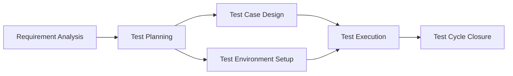
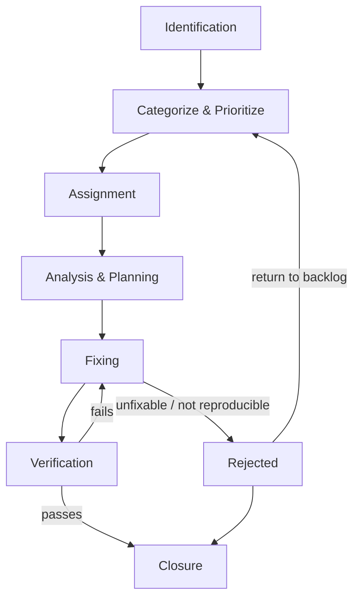

# Test Team Organization

## Table of Contents

* [1. High-Level Overview](#1-high-level-overview)
* [2. The Roles in a Testing Team](#2-the-roles-in-a-testing-team)
    * [2.1 Test Manager](#21-test-manager)
    * [2.2 Tester](#22-tester)
    * [2.3 Business Analyst](#23-business-analyst)
    * [2.4 Stakeholder](#24-stakeholder)
* [3. The Software Testing Life Cycle (STLC)](#3-the-software-testing-life-cycle-stlc)
    * [3.1 Phase 1: Requirement Analysis](#31-phase-1-requirement-analysis)
    * [3.2 Phase 2: Test Planning](#32-phase-2-test-planning)
    * [3.3 Phase 3: Test Case Design](#33-phase-3-test-case-design)
    * [3.4 Phase 4: Test Environment Setup](#34-phase-4-test-environment-setup)
    * [3.5 Phase 5: Test Execution](#35-phase-5-test-execution)
    * [3.6 Phase 6: Test Cycle Closure](#36-phase-6-test-cycle-closure)
* [4. The Defect Life Cycle](#4-the-defect-life-cycle)
    * [4.1 Defect Identification](#41-defect-identification)
    * [4.2 Categorization & Prioritization](#42-categorization--prioritization)
    * [4.3 Assignment](#43-assignment)
    * [4.4 Analysis & Planning](#44-analysis--planning)
    * [4.5 Fixing](#45-fixing)
    * [4.6 Verification](#46-verification)
    * [4.7 Closure](#47-closure)
* [5. Test Documentation](#5-test-documentation)
    * [5.1 Test Plan](#51-test-plan)
    * [5.2 Test Schedule](#52-test-schedule)
    * [5.3 Requirement Traceability Matrix](#53-requirement-traceability-matrix)
    * [5.4 Software Requirements Specification](#54-software-requirements-specification)
    * [5.5 Test Progress Report](#55-test-progress-report)
    * [5.6 Test Summary Report](#56-test-summary-report)

***

## 1. High-Level Overview

**Test Team Organization** is the framework of people, processes, and artifacts that together ensure a software product meets its quality standards. It comprises three interlocking concerns: the **roles** who own testing, the **Software Testing Life Cycle (STLC)** that sequences the work, and the **documentation** that records decisions, scope, and results.

The team's structure defines *who does what*; the STLC defines *what happens when*; the defect life cycle defines *how bugs travel from discovery to closure*; and the artifacts tie it all together, keeping every stakeholder aligned on scope, progress, and quality.

[↑ Back to Table of Contents](#table-of-contents)

***

*Before we examine the phases, let's look at the people who drive them: every testing effort is shaped by a handful of well-defined roles.*

## 2. The Roles in a Testing Team

A testing team is not a single job title but a collection of distinct responsibilities that must cooperate for testing to succeed. Each role contributes a different perspective and set of deliverables.

| Role | Core Responsibility | Key Deliverables | Interfaces With |
| :--- | :--- | :--- | :--- |
| **Test Manager** | Owns the overall testing process and strategy. | Test strategy, test plan, resource & team management. | Development, business, stakeholders, all testers. |
| **Tester** | Executes tests and validates behavior against requirements. | Test cases, bug reports, verification results. | Developers, Test Manager. |
| **Business Analyst** | Bridges business intent and technical implementation. | Clarified requirements, resolved ambiguities, analysis. | Business side, technical team. |
| **Stakeholder** | Represents the interests of customers, users, or management. | Requirements input, feedback, go/no-go decisions. | Test Manager, BAs, sometimes testers directly. |

> [!NOTE]
> These roles are about **functions, not job titles**. In a small team, one person may wear several hats (e.g., a Test Manager who also writes test cases); in a large organization, each function may be a department. Focus on what the role *contributes*, not the name on the org chart.

### 2.1 Test Manager

The **Test Manager** is responsible for overseeing the entire testing process, ensuring that it aligns with the project's goals and quality standards. They develop the test strategy, manage the testing team, and coordinate with other departments. Beyond planning, they ensure testing resources are used effectively so the process stays both efficient and thorough.

### 2.2 Tester

**Testers** identify defects by executing tests and ensure the software functions as expected against specified requirements. Their key tasks include writing and executing test cases, reporting bugs, and verifying fixes. They often work closely with developers to understand the software and its potential failure points, contributing directly to overall product quality.

### 2.3 Business Analyst

**Business Analysts** act as a bridge between the business and technical teams. They combine business understanding with technical knowledge to analyze documentation and requests from both sides. When a misunderstanding or blocker arises between business intent and technical delivery, it is the **Business Analyst's** job to clarify and clear it.

### 2.4 Stakeholder

**Stakeholders** represent the interests of everyone with a stake in the project — customers, users, or management. They provide input on requirements and feedback on performance. Their responsibilities include reviewing test results, giving feedback, and making decisions based on testing outcomes, ensuring the software meets its intended users' needs and expectations.

> [!TIP]
> In Agile projects the roles shift emphasis: the Business Analyst and Stakeholder tend to collapse into an active **Product Owner**, while the Tester becomes embedded in the development team rather than a separate test department.

[↑ Back to Table of Contents](#table-of-contents)

***

*With the team defined, we can now look at how their work is sequenced: the phases that every testing effort passes through.*

## 3. The Software Testing Life Cycle (STLC)

The **Software Testing Life Cycle (STLC)** is the sequence of phases a testing effort follows, from understanding requirements to closing out the cycle. Each phase has concrete inputs and outputs, and together they ensure testing is planned, executed, and reviewed systematically rather than ad hoc.

Note how **Test Case Design** (Phase 3) and **Test Environment Setup** (Phase 4) run *in parallel* in this example after planning — both must finish before real execution can begin, so both phases of work can be done in parallel.

### 3.1 Phase 1: Requirement Analysis

The **Requirement Analysis Phase** is where the test team examines the software requirements to ascertain the scope of testing. This involves identifying both functional and non-functional requirements to understand what must be delivered.

| Key Activity | Purpose |
| :--- | :--- |
| **Requirement Review** | Thoroughly review the requirements documentation to understand expected functionality and performance criteria. |
| **Stakeholder Discussions** | Engage BAs, developers, and clients to clarify ambiguities and gather additional detail. |
| **Feasibility Study** | Assess feasibility from a testing perspective and identify potential challenges or constraints. |
| **Requirements Traceability Matrix (RTM)** | Develop an RTM ensuring every requirement is covered by test cases, providing traceability throughout. |

By the end of this phase, the test team should have a clear understanding of *what* needs to be tested and a strategy for *how* to approach it.

### 3.2 Phase 2: Test Planning

The **Test Planning Phase** follows requirement analysis, where a Testing Manager or senior team member drafts a comprehensive test plan covering strategy, objectives, resources, schedule, and scope.

| Key Activity | Purpose |
| :--- | :--- |
| **Test Plan Development** | Craft a detailed test plan defining the approach, test types, testing levels, and environment. |
| **Effort & Cost Estimation** | Calculate effort and costs, including resource allocation, tooling, and expenses. |
| **Resource Planning** | Identify and assign tools, hardware, software, and personnel. |
| **Risk Analysis** | Identify risks and limitations, then develop mitigation strategies. |
| **Scheduling** | Establish timelines, milestones, and deadlines for each activity. |

> [!IMPORTANT]
> The test plan is the **contract** of the testing effort. Skip this phase and every later phase loses its foundation — scope, cost, and schedule are all defined here before any test is written.

By the end of this phase, the test team should have a well-defined test plan that serves as a roadmap for the phases that follow.

### 3.3 Phase 3: Test Case Design

The **Test Case Design Phase** focuses on creating detailed test cases and organizing the test data needed to run them, based on the established test plan.

| Key Activity | Purpose |
| :--- | :--- |
| **Test Case Creation** | Develop comprehensive test cases covering functional and non-functional requirements, each with steps, expected results, and acceptance criteria. |
| **Test Script Development** | Write automated test scripts for efficient, repeatable execution where applicable. |
| **Test Data Preparation** | Generate or identify the test data needed so every scenario can be executed. |
| **Review & Refinement** | Run peer reviews/walkthroughs to ensure accuracy and completeness; refactor based on feedback. |
| **Parallel Activities** | Execute in parallel with Test Environment Setup to optimize the schedule. |

By the end of this phase, the test team should have a robust set of test cases and scripts ready for execution.

### 3.4 Phase 4: Test Environment Setup

The **Test Environment Setup Phase** establishes the software and hardware environment that closely replicates production conditions for the work product.

| Key Activity | Purpose |
| :--- | :--- |
| **Environment Configuration** | Set up software, hardware, and network configurations that mirror production. |
| **Environment Validation** | Verify the environment is correctly configured and functioning; flag discrepancies. |
| **Tool Installation** | Install and configure testing tools and frameworks needed for execution. |
| **Data Setup** | Ensure required test data is available and correctly loaded. |
| **Parallel Execution** | Run in parallel with Test Case Design so the environment is ready when cases finalize. |

By the end of this phase, the test team should have a fully functional environment ready for test execution.

### 3.5 Phase 5: Test Execution

The **Test Execution Phase** is where the actual testing happens. Testers execute the developed test cases to validate the functionality and performance of the product.

| Key Activity | Purpose |
| :--- | :--- |
| **Test Script Execution** | Run automated scripts and manually execute test cases per the test plan. |
| **Script Maintenance** | Update and maintain scripts to accommodate software or environment changes. |
| **Bug Reporting** | Log defects with reproduction steps, expected/actual results, and screenshots/logs. |
| **Retesting** | Re-execute previously failed cases after fixes to confirm resolution. |
| **Regression Testing** | Verify recent changes haven't adversely affected existing functionality. |
| **Report Generation** | Compile execution reports summarizing cases run, passed, failed, and defects found. |

> [!TIP]
> **Retesting ≠ regression testing.** Retesting verifies *the specific fix*, while regression testing checks that changes didn't *break anything else*. Both are needed — they answer different questions.

By the end of this phase, the test team should have a clear picture of software quality and release readiness, based on results and identified issues.

### 3.6 Phase 6: Test Cycle Closure

The **Test Cycle Closure Phase** is the final STLC stage, signifying completion of test execution and containing several wrap-up activities.

| Key Activity | Purpose |
| :--- | :--- |
| **Test Cycle Review** | Hold a comprehensive review meeting to analyze execution reports, defect logs, and artifacts. |
| **Metrics & Reporting** | Present metrics such as test coverage, defect density, and execution status. |
| **Lessons Learned** | Identify successes, best practices, and improvements; document them for future cycles. |
| **Test Artifacts Archival** | Organize and archive cases, scripts, defect reports, and logs for future reference. |
| **Environment Teardown** | Decommission the test environment and release allocated resources. |
| **Sign-off** | Obtain formal stakeholder sign-off that the software is ready for release. |

> [!TIP]
> The closure phase is what makes testing **improve over time**. If you skip Lessons Learned, the same mistakes silently repeat in every future cycle — the archived metrics become the baseline you compare against.

By the end of this phase, the test team should have documented insights that drive continuous improvement in future projects.

[↑ Back to Table of Contents](#table-of-contents)

***

*While the STLC covers the overall effort, individual bugs follow their own journey. Let's trace a defect from discovery to resolution.*

## 4. The Defect Life Cycle

The **defect life cycle** describes the states a single defect moves through from discovery to closure. Understanding it matters because each transition has an owner, a decision, and a document trail — a defect that "gets stuck" usually means a transition was skipped.

> [!NOTE]
> **Further Reading:** Baeldung has a solid write-up on the defect life cycle — [Defect Life Cycle (Baeldung)](https://www.baeldung.com/cs/defect-life-cycle-testing).

### 4.1 Defect Identification

In the **Defect Identification** phase, a defect is detected and logged during code reviews, testing, or by end-users. It is documented with relevant data — steps to reproduce, screenshots, logs — and entered into a defect tracking system with all necessary information.

### 4.2 Categorization & Prioritization

During **Categorization & Prioritization**, the defect's **severity** (critical, major, minor) and **priority** (high, medium, low) are assessed based on user impact, frequency, and business importance. This determines the order and urgency of the resolution process.

> [!IMPORTANT]
> **Severity ≠ Priority.** *Severity* measures technical impact (how broken it is); *priority* measures business urgency (how fast it must be fixed). A cosmetic typo on a homepage can be **high priority but low severity**, while a rare crash deep in a feature could be **high severity but low priority** — don't conflate the two.

### 4.3 Assignment

In the **Assignment** phase, a project manager or lead developer reviews the defect and assigns it to the team or individual with the necessary expertise, along with a tentative timeline for resolution.

### 4.4 Analysis & Planning

The **Analysis & Planning** phase involves understanding the defect's root cause by reviewing code, reproducing the defect, and identifying the underlying issue. It also includes planning the fix, estimating effort, and determining impact on other system parts.

### 4.5 Fixing

The **Fixing** phase is where the actual coding to resolve the defect takes place. Actions include modifying the code, running unit tests, and ensuring the fix introduces no new defects. If the assignee can't fix it, or a tester can't reproduce it, or another blocker arises, the defect may be **rejected** and returned to the backlog or removed entirely.

> [!WARNING]
> **"It's not a bug, it's a feature."** A defect can be rejected when the reported behavior is actually intended. Always confirm with a stakeholder before rejecting — an improperly rejected defect erases a real issue and undermines the tracking system's credibility (the classic "won't fix" bias).

### 4.6 Verification

In the **Verification** phase, the fix is retested **in the same environment** where it was originally found, and regression testing is run to ensure no new issues were introduced. This confirms the fix works and the system remains stable.

### 4.7 Closure

During **Closure**, the tracking system is updated to reflect the closure, stakeholders are informed, and lessons learned are documented.

### Defect Life Cycle Flowchart

[↑ Back to Table of Contents](#table-of-contents)

***

*Roles and life cycles drive the work, but none of it succeeds without record-keeping. Let's look at the documents that anchor the process.*

## 5. Test Documentation

Test documentation is the written record that keeps every phase of testing aligned and auditable. Each artifact has a distinct job, and they relate to one another.

| Document | Purpose | Key Contents | Produced In |
| :--- | :--- | :--- | :--- |
| **Test Plan** | The master strategy for the whole testing effort. | Objectives, schedule, estimates, deliverables; references other docs. | Phase 2 (Planning). |
| **Test Schedule** | The timeline for completing testing activities. | When each part of the software is tested; a living doc in Agile. | Phase 2 (Planning). |
| **Requirements Traceability Matrix (RTM)** | Bidirectional map of requirements ↔ tests ↔ defects; coverage proof + impact analysis. | Forward (req → test → defect) and backward (test → req) links, with an execution/defect status. | Begun Phase 1, maintained throughout. |
| **Software Requirements Specification (SRS)** | Detailed description of the system to be built. | Functional & non-functional requirements, interfaces, constraints. | Before/during Phase 1 (the test basis). |
| **Test Progress Report** | Tracks tests designed and executed during the cycle. | Cases run/passed/failed, defects found, status vs. schedule. | Throughout Phase 5. |
| **Test Summary Report** | Aggregates final results per test run or cycle. | Same metrics, organized by run/cycle; basis for milestone decisions. | At milestones / end of Phase 6. |

### 5.1 Test Plan

A **test plan** is a comprehensive document outlining how a team will manage testing for a product or system, including objectives, schedule, estimates, and deliverables. It serves as a central hub, specifying the need for other documents like the test case document and the RTM. Known variously as a "master test plan", "level test plan", or "test scope", it coordinates testing activities to ensure full coverage aligned with project goals.

### 5.2 Test Schedule

A **test schedule** outlines the timeline for completing various testing activities, specifying when each part of the software is tested to enable timely testing. In Agile, this is a **living document** — continuously updated as the project progresses. It helps coordinate efforts across teams, prevent bottlenecks, and allocate resources efficiently.

> [!TIP]
> In Agile, treat the schedule as a living plan, **not a fixed promise**. Because it's updated continuously, it stays useful as a coordination tool even as scope shifts — that flexibility is its strength, not a sign of poor planning.

### 5.3 Requirement Traceability Matrix

A **requirements traceability matrix (RTM)** is a living cross-reference that links every requirement to the test cases that validate it and the defects those tests surface. Its defining characteristic is **bidirectional traceability**:

| Direction | Path | What it Answers | Failure It Catches |
| :--- | :--- | :--- | :--- |
| **Forward** | Requirement → Test Case → Defect | "Which tests (and defects) cover this requirement?" | Requirements with no coverage → gaps. |
| **Backward** | Test Case → Requirement | "Which requirement does this test validate?" | Tests with no requirement → scope creep / orphan tests. |

Typical columns: requirement ID, description / user story, acceptance criteria, linked test case ID(s), execution status, and any defect IDs reported against it.

> [!IMPORTANT]
> **Traceability is bidirectional — that's the point.** A unidirectional matrix (requirement → test only) proves coverage but can't prove the reverse: that every test is justified by a requirement. A test with no mapping upstream is either unnecessary scope or a gap in your requirements — and only the backward direction reveals it.

Why you keep it updated, not just build it:

| Use | Value |
| :--- | :--- |
| **Coverage proof** | Show all requirements are covered by at least one test. |
| **Impact analysis** | When a requirement changes, immediately identify every affected test and defect instead of hunting manually. |
| **Gap & orphan detection** | Spot requirements with no tests and tests with no requirement. |
| **Audit / compliance** | Objective record of coverage for regulated or contractual work. |

> [!NOTE]
> The RTM isn't a static diagram built once — it's a **living document** maintained across every phase. It starts in Requirement Analysis and is updated as requirements, tests, and defects evolve.

### 5.4 Software Requirements Specification

A **software requirements specification (SRS)** is a detailed, structured description of the software to be developed, serving as a guide for both the development and testing teams and stakeholders. Its core is the **functional requirements** (specific behaviors the software must perform), alongside **non-functional requirements** (performance, security, usability), **external interface requirements**, and **design constraints**. It serves as the **test basis** — the reference the test team uses to design and validate.

### 5.5 Test Progress Report

A **test progress report** tracks the progress of tests designed and executed, providing an overview of testing activity. Working with the Test Schedule, it details the status of completed and in-progress tests — including cases executed, passed, failed, and defects identified. Keeping it current lets teams spot bottlenecks early and make informed decisions.

### 5.6 Test Summary Report

A **test summary report** aggregates and displays the results of test case executions for one or more test objects. Partial results may appear in a progress report, but the entirety of results belongs in this dedicated document, typically organized by test run or cycle. Like the progress report it includes cases executed, status, and defects — but at a consolidated, milestone-level view consulted when deciding whether development and testing should progress.

[↑ Back to Table of Contents](#table-of-contents)
