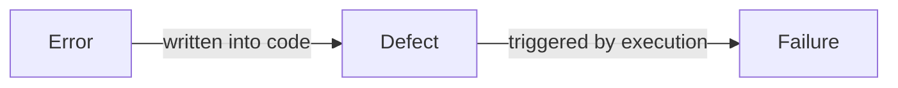
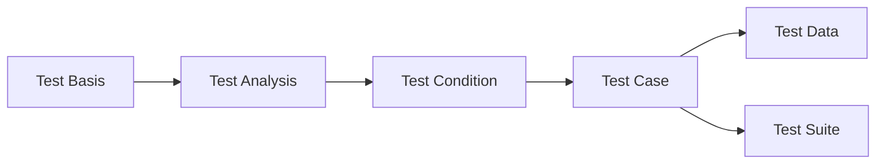

# Testing Philosophy

## Table of Contents

* [1. High-Level Overview](#1-high-level-overview)
* [2. Core Definitional Concepts](#2-core-definitional-concepts)
    * [2.1 Quality Assurance vs Quality Control](#21-quality-assurance-vs-quality-control)
    * [2.2 Verification vs Validation](#22-verification-vs-validation)
    * [2.3 Error vs Defect vs Failure](#23-error-vs-defect-vs-failure)
    * [2.4 Requirements](#24-requirements)
* [3. The Testing Mindset](#3-the-testing-mindset)
    * [3.1 Tester vs Developer Mindset](#31-tester-vs-developer-mindset)
    * [3.2 Static vs Dynamic Testing](#32-static-vs-dynamic-testing)
    * [3.3 Automated vs Manual Testing](#33-automated-vs-manual-testing)
* [4. Levels of Testing](#4-levels-of-testing)
* [5. Types of Testing](#5-types-of-testing)
* [6. Testing Components (The Vocabulary)](#6-testing-components-the-vocabulary)
* [7. Test Case Design: Positive vs Negative Testing](#7-test-case-design-positive-vs-negative-testing)

***

## 1. High-Level Overview

**Testing philosophy** is the underlying set of beliefs, goals, and vocabulary that shapes how software is tested. Before learning specific tools or steps, it helps to agree on a few foundational truths about what testing is *for* and the language we use to talk about it.

Three ideas anchor everything else in this guide:
1. **We cannot prove the absence of bugs** — testing shows the presence of defects, not their absence. Its goal is to build *confidence* and reduce risk, not to achieve perfection.
2. **Most of the value comes from cheap, early correction** — the earlier a problem is found, the cheaper it is to fix. This belief drives the level of testing you choose (Section 4) and when you apply it.
3. **The tester and the developer are on the same team** — they differ in *approach*, not in goal. Both want a high-quality product that serves its stakeholders.

[↑ Back to Table of Contents](#table-of-contents)

***

*Every testing conversation hinges on a handful of distinctions people confuse. Let's settle the biggest ones up front.*

## 2. Core Definitional Concepts

The testing world is full of terms that are used interchangeably in casual conversation but actually name different things. The distinctions below are the ones most commonly tested, and getting them straight unlocks everything else.

### 2.1 Quality Assurance vs Quality Control

**Quality Assurance (QA)** and **Quality Control (QC)** are frequently used as synonyms — they are not. The difference is the point of view: is the problem being *prevented* or *detected*?

| Dimension | Quality Assurance (QA) | Quality Control (QC) |
| :--- | :--- | :--- |
| **Orientation** | Process-oriented | Product-oriented |
| **Nature** | Preventive | Corrective |
| **Focus** | Improving the *process* that produces the product | Identifying and fixing *defects* in the finished product |
| **Goal** | Ensure good processes lead to good products | Ensure the product meets quality standards |
| **Testing's role** | Test results feed back into process improvement | Testing *is* QC — detecting and fixing defects |

> [!IMPORTANT]
> **The trap to avoid:** treating "testing" and "QA" as the same thing. Testing is a **quality control** activity — it detects and corrects defects in the product. QA is broader: it improves the *process* so defects are less likely to be created in the first place. A team that only "does QA" by testing still needs process improvement to truly practice QA.

### 2.2 Verification vs Validation

Almost all testing can be classified as **verification** or **validation**. They ask different questions:

- **Verification** asks *"are we building the product **correctly**?"*
- **Validation** asks *"are we building the **right** product?"*

| Dimension | Verification | Validation |
| :--- | :--- | :--- |
| **Question** | Are we building the product correctly? | Are we building the right product? |
| **Focus** | Conformance to specifications/design | Fit for the end user's actual needs |
| **Output** | Confirms "yes, it matches the spec" | Confirms "yes, users will find it useful" |

> [!NOTE]
> Do not conflate this axis with **static vs dynamic** (Section 3.2) — those are orthogonal. Static testing (no code execution) is *often* used for verification, and dynamic testing is *often* used for validation, but verification and validation can each be done either way. Running tests to confirm a build meets spec is *dynamic verification*; a requirements walkthrough to confirm the spec matches user intent is *static validation*.

**Worked example: building a bike.**
- **Verification** = checking the bike is assembled to its design requirements: the frame uses the specified material, the brakes are designed per spec, the correct number of gears is accommodated. It confirms the *build* matches the *plan*.
- **Validation** = taking the bike for a ride in real conditions to confirm it is comfortable, safe, and performs on different terrains and weather. It confirms the *product* serves the *rider*.

### 2.3 Error vs Defect vs Failure

These three terms describe one causal chain, and each has a precise meaning:

- An **error** is a *mistake made by a person* — mis-calling a variable, forgetting a business rule, a misunderstanding. Errors are held *in code* as the latent problem.
- A **defect** (a.k.a. "bug") is an *incorrect behavior or failed requirement present in the software*. An error, once it ends up in the code, produces a defect. *All failures are defects, but not all defects are failures* — a defect only becomes a failure when it is actually triggered.
- A **failure** is what happens when a *defect is executed* in a running system and the intended behavior deviates from the expected. A defect that sits dormant in code is not yet a failure; the moment a user or test triggers it, it is.



| Component | What it is |
| :--- | :--- |
| **Error** | A mistake made by a person (mis-calling a variable, forgetting a business rule, a misunderstanding); held in code as the latent problem. |
| **Defect** | The incorrect behavior or failed requirement present in the software once the error is written into code. |
| **Failure** | The visible deviation from expected behavior when a defect is executed in a running system. |

> [!NOTE]
> Not every defect is a failure, even when it exists, because not every defect is reachable or triggered. Examples of defects that may never surface as obvious failures: aesthetic issues, sub-par performance (latency, throughput), incorrect documentation, and accessibility gaps. They are still defects worth tracking — they degrade quality even when the app "works."

### 2.4 Requirements

**Requirements** specify what should be included in (or excluded from) a product — covering business, technical, regulatory, and accessibility needs. They are the material both developers and testers work from, so their form matters as much as their substance.

Common standardized formats:
| Format | What it Looks Like |
| :--- | :--- |
| **Software Requirements Specification (SRS)** | Formal, detailed, structured statement of functional/non-functional requirements. |
| **Use Cases** | Interactions between a user and the system to achieve a goal. |
| **User Stories** | Short, Agile-friendly descriptions from a user's perspective; usually "As a…, I want…, so that…". |
| **Non-Functional Specifications** | Quality attributes: performance, security, usability, scalability. |

[↑ Back to Table of Contents](#table-of-contents)

***

*With the vocabulary settled, let's turn to the mindset and approach — how testers think, and the two big methodological axes.*

## 3. The Testing Mindset

### 3.1 Tester vs Developer Mindset

Testers and developers share the same end goal — a high-quality product that meets stakeholder needs — but approach it from opposite directions.

| Dimension | Tester | Developer |
| :--- | :--- | :--- |
| **Orientation** | Problem-oriented | Goal-oriented |
| **Primary instinct** | *How can this break?* | *How can I make this work?* |
| **Perspective** | Adopts the user's perspective; real-world scenarios and usability | Solution-focused; functional, efficient, scalable code |
| **View of risk** | Risk of failure, edge cases, unmet requirements | Risk of technical challenge, performance, scalability |
| **Contribution** | Uncovers weaknesses and vulnerabilities; drives quality assurance | Builds features; writes clean, performant code |

They are complementary: the developer pushes the product forward; the tester makes sure the forward motion doesn't leave gaps behind.

> [!TIP]
> A tester's job is to be *skeptical and curious*, not adversarial. The most effective testers frame their goal as partnership — "prove this works *and* find where it doesn't" — rather than "catch the developers' mistakes."

### 3.2 Static vs Dynamic Testing

**Static testing** evaluates software *without running it*. It inspects documentation, code syntax, requirements, and other auxiliary resources. **Dynamic testing** evaluates software *while it is running*, executing the application to observe its behavior.

| Dimension | Static Testing | Dynamic Testing |
| :--- | :--- | :--- |
| **Software running?** | No | Yes |
| **What it reviews** | Requirements, design docs, code reviews, walkthroughs, syntax | Actual execution; inputs, outputs, behavior |
| **When it can happen** | Before code runs (very early) | Only once code is runnable |

> [!TIP]
> Static testing is the cheapest kind — it finds defects *before* there is anything to execute. Reviews and walkthroughs usually catch problems in minutes that would take a full test cycle to surface dynamically.

### 3.3 Automated vs Manual Testing

| Dimension | Automated Testing | Manual Testing |
| :--- | :--- | :--- |
| **Human error** | None at execution time — but scripts carry their own maintenance risk (flaky tests, stale assertions). | Present, but mitigable with training and care |
| **Speed / feedback** | Fast; frequent cycles | Slower |
| **Upfront investment** | High (tooling, scripts) | Low; less technical knowledge required |
| **Long-term cost** | Low — once built, re-runs are cheap | High — repetitive manual runs consume human time |
| **Availability** | Can run 24/7 — ideal for CI/CD | Only when a person is available |
| **Best suited for** | Unit, integration, and system testing; complex/large apps; repetitive suites | Acceptance testing; subjective criteria; small/simple apps |
| **Nature** | Dynamic testing (software must run) | Often static (reviews) or dynamic (exploratory) |

> [!IMPORTANT]
> **Automation is not free.** It saves time on *repetitive, stable* tests that run often — but writing and maintaining scripts is an investment. Automating a test you'll run three times is often a net loss; automating a suite you'll run nightly in CI is an obvious win.

[↑ Back to Table of Contents](#table-of-contents)

***

*With the philosophy clear, we move from mindset to structure: at what "size" do we test, and what kinds of tests do we run?*

## 4. Levels of Testing

**Levels of testing** are defined by the *size of the unit* under test and *when* testing happens in the build process. They form a pyramid, with many small, cheap, fast tests at the base and few large, slow ones at the top.

```text
                         / \
                        /   \
                       / UAT \
                      /-------\
                     /         \
                    /  System   \
                   /_____________\
                  /               \
                 /   Integration   \
                /___________________\
               /                     \
              /         Unit          \
             /_________________________\
```

| Level | What is Tested | Who Typically Writes It | Goal |
| :--- | :--- | :--- | :--- |
| **Unit** | Individual function/module in isolation | Developers | Verify each piece works correctly on its own |
| **Integration** | Groups of modules and the interfaces between them | Developers / testers | Verify components work *together* |
| **System** | The fully assembled application | Testers | Verify the whole system meets requirements |
| **Acceptance** | The finished product from the user's perspective | Testers with business/stakeholders | Confirm it satisfies real user needs; readiness to release |

> [!NOTE]
> The higher the level, the more it resembles real usage — and the more expensive it is to run. That's *why* the pyramid is wider at the bottom: put your small, fast tests there so most bugs are caught cheaply and early.

[↑ Back to Table of Contents](#table-of-contents)

***

*Levels tell us the size of what we test; types tell us what aspect we're examining.*

## 5. Types of Testing

**Types of testing** describe *what we're looking for* during testing. They cross the levels: you can run performance tests at the system level, or security tests on a single module.

The broadest split is **functional** (does the software do what it should?) vs **non-functional** (does it do it well enough — fast, secure, usable?).

| Type | Objective | When it Typically Runs | Automated or Manual? |
| :--- | :--- | :--- | :--- |
| **Smoke** | Quick sanity check on the main functionality; "is it alive?" | Early, after each build/deploy | Usually automated |
| **Sanity** | Narrow, targeted check that a specific change works | After a fix or small change | Usually manual/light |
| **Regression** | Confirm recent changes didn't break existing behavior | After every change, often nightly in CI | Automated |
| **Exploratory** | Unscripted, discovery-oriented testing to learn the system | Any time; great for new features | Manual |
| **Performance** | Verify it handles load, latency, throughput, scalability | Pre-release, at scale | Automated |
| **Security** | Verify it resists unauthorized access, injection, etc. | Pre-release, continuous | Mixed |
| **Usability** | Verify it is intuitive and meets user expectations | Design / UAT stages | Mostly manual |
| **Acceptance (UAT)** | Confirm the product meets end-user requirements and is releasable | Final stage, with stakeholders | Manual (or automated E2E) |

> [!TIP]
> **Smoke vs. sanity** is a common confusion. Smoke is *broad but shallow* — does the app boot and the main flows work? Sanity is *narrow but deep* — does this specific fix do exactly what it should? Smoke asks "is it alive?"; sanity asks "did it actually get fixed?"

[↑ Back to Table of Contents](#table-of-contents)

***

*Now we descend to the building blocks: the specific pieces of a testing effort and the vocabulary used to describe them.*

## 6. Testing Components (The Vocabulary)

Everything in testing is built from a small set of connected components. Understanding how they chain together is more valuable than memorizing each definition in isolation:



- **Test Basis** — the complete body of knowledge you test against: requirement specifications, design documents, risk analysis, and traceability reports. It is the foundation for everything downstream.
- **Test Analysis** — the activity of studying the test basis to determine *what* needs to be tested, surfacing **test conditions** and understanding risks. Its output drives test design.
- **Test Condition** — a specific aspect of the software that must be evaluated (functional, performance, security, usability, and more). Example: "verify login works correctly," or "verify the app handles N concurrent users."
- **Test Objective** — the *reason* for testing. Common objectives: evaluate work products against standards, identify defects, ensure coverage and compliance, reduce risk by finding issues early, provide information to stakeholders, and build confidence in the product.
- **Test Object** — the resource being evaluated (a module, a subsystem, the whole product). Clearly scoping it keeps tests targeted and the coverage well understood.
- **Test Case** — a formal, detailed set of **preconditions, inputs, actions, and expected results** built from test conditions. On execution, the actual outcome is compared to the expected: a match = **passed**; a deviation = **failed**, revealing a defect.
- **Test Data** — the values used as input by the test cases. Sorted out during analysis, then specified precisely when conditions become tests. For a username-constraint objective, you'd first determine the constraints (length, character types, uniqueness), then supply valid (and invalid) values.
- **Test Suite** — a grouping of related test cases, organized by shared objective, object, or data.

> [!TIP]
> There is a quiet irony at the heart of testing: a tester "succeeds" when one of their tests *fails* due to unexpected behavior — they found a defect. Better that the tester discovers it in the test environment than that an end user discovers it in production.

> [!NOTE]
> **Test data drives test outcomes.** Whether your test data *complies* with or *violates* the requirements determines what kind of testing you're doing — which leads directly to the last topic.

[↑ Back to Table of Contents](#table-of-contents)

***

*Finally, a core choice every test case makes: do we feed it valid data to confirm success, or invalid data to confirm graceful failure?*

## 7. Test Case Design: Positive vs Negative Testing

Test cases fall into two fundamental styles, defined by the nature of the data they use.

| Dimension | Positive ("Happy Path") Testing | Negative ("Sad Path") Testing |
| :--- | :--- | :--- |
| **Data used** | Fully complies with requirements | Does not conform to requirements |
| **Input** | Valid, expected values | Invalid, unexpected, malformed values |
| **Goal** | Confirm normal operation succeeds | Confirm the system handles bad input gracefully |
| **Expected result** | Action completes successfully | No crash; clear, appropriate error handling |
| **What it proves** | The software works under normal conditions | The software is robust, secure, and stable under adverse conditions |

> [!IMPORTANT]
> **Both are required.** Positive testing proves the happy path works; negative testing proves the system won't *break* when things go wrong. A login that only accepts valid credentials but crashes on a malformed input is fragile — negative testing is what finds the vulnerabilities and edge cases. Skip it and you ship a system that works perfectly until the moment it doesn't.

[↑ Back to Table of Contents](#table-of-contents)
